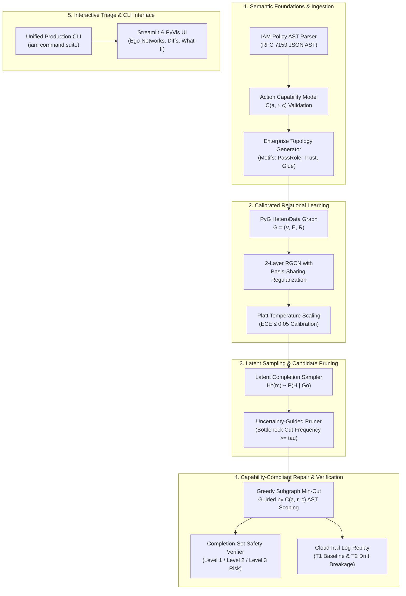

# Uncertainty-Aware Least-Privilege Repair for Cloud IAM under Partial Observability

[]()
[]()
[]()
[]()
[]()
[]()
[]()

An enterprise cloud security research framework for inferring latent authorization relationships with calibrated uncertainty and synthesizing capability-compliant least-privilege IAM policy repairs under partial observability.

---

## 1. Problem Motivation & Research Overview

Modern cloud environments (AWS, Azure, GCP) contain tens of thousands of identities (users, service roles, machine principals) whose effective permissions are determined by non-trivial combinations of identity-based policies, resource policies, permission boundaries, and session policies. In these environments, **privilege escalation (PE)** rarely occurs via a single misconfigured permission; instead, attackers chain subtle, multi-hop transitive authorizations—such as role assumption (`sts:AssumeRole`), permission modification (`iam:AttachRolePolicy`), or service delegation (`iam:PassRole`).

Existing formal analysis and model-checking tools (e.g., PMapper, AWS IAM Access Analyzer) rely on **complete-state observability**: they construct a deterministic reachability graph under the assumption that all entity definitions, policy documents, and trust relationships are known.

**The Partial Observability Reality**:
In real-world multi-account cloud environments, complete-state observability is fundamentally broken due to:
1. **Cross-Account Trust Boundaries**: External trust relationships link to foreign accounts whose internal role graphs and policy definitions cannot be scanned.
2. **Telemetry Gaps & Logging Blackouts**: Unmonitored VPCs, transient microservices, and unlogged IAM changes hide critical operational transitions.
3. **Third-Party SaaS Integrations**: Vendor roles assume identities without publishing their internal delegation graphs.

```text
Traditional Deterministic Analysis (PMapper / Access Analyzer):
   Observed Graph Go ──[BFS / SMT]──► Misses Unobserved Bridge ──► FALSE SENSE OF SECURITY (Zero Risk Reported)

Our Uncertainty-Aware Framework:
   Observed Graph Go ──[2-Layer RGCN]──► P(H | Go) ──[Temp Scaling]──► Calibrated Latent Completions H^(m)
                                                                                  │
   Capability-Compliant Patch P* ◄──[Sound AST Verifier] ◄──[Greedy Min-Cut C(a,r,c)]
```

When a single bridge relation is unobserved, deterministic tools suffer **zero recall** on latent attack paths. Conversely, naive heuristic repair tools (such as IAMPERE) strip entire dangerous actions (`iam:PassRole`), incurring catastrophic operational breakage on legitimate CI/CD and production workloads.

This repository provides an end-to-end framework that:
1. **Learns Inductive Graph Representations** of IAM multigraphs using Relational Graph Convolutional Networks (RGCN).
2. **Produces Calibrated Uncertainty Estimates** ($\text{ECE} \le 0.05$) via post-hoc temperature scaling.
3. **Samples Latent Graph Completions** to quantify reachability risk distributions across unobserved attack paths.
4. **Synthesizes Capability-Compliant Repairs** governed by an explicit AWS Action Capability Model $C(a, r, c)$ to eliminate escalation paths without breaking legitimate workloads.
5. **Verifies Residual Safety** across three distinct levels of ground truth ($G_o$, completions $\mathcal{H}_M$, and oracle $G^*$).

---

## 2. System Architecture

The framework comprises five pipelined subsystems operating across formal AST parsing, neural message passing, combinatorial optimization, and interactive security triage:



---

## 3. Mathematical Formulation

### 3.1 Relational Multigraph Schema
An enterprise cloud authorization environment is formalized as a directed heterogeneous multigraph:

$$
G = (V, E, \mathcal{R})
$$

where:
- Node entity types: $V = V_{\text{User}} \cup V_{\text{Role}} \cup V_{\text{Policy}} \cup V_{\text{Group}} \cup V_{\text{Resource}} \cup V_{\text{Condition}}$.
- Edge relation types: $\mathcal{R} = \{\text{AttachedTo}, \text{AssumesRole}, \text{HasPolicy}, \text{TargetsResource}, \text{PassesRoleTo}, \text{AppliesCondition}, \dots\}$.

### 3.2 AWS Action Capability Model $C(a, r, c)$
AWS authorization enforcement is heterogeneous: applying resource constraints to actions that AWS forbids resource-level permissions causes immediate deployment errors. We formalize this constraint via the capability mapping:

$$
\mathcal{T}(a) = \begin{cases}
\text{ARN-Restricted} & \text{if } a \text{ supports resource-level scoping (e.g. s3:GetObject, iam:PassRole)} \\
\text{Global-Only} & \text{if } a \text{ requires wildcard resources (e.g. iam:CreatePolicyVersion)}
\end{cases}
$$

Candidate policy remediations must strictly satisfy:

$$
\text{ValidPatch}(P, a) \iff \begin{cases}
\text{ScopeResource}(P, a, \text{ARN}) & \text{if } \mathcal{T}(a) = \text{ARN-Restricted} \\
\text{InjectCondition}(P, a, \text{Key}, \text{Val}) & \text{if } \mathcal{T}(a) = \text{Global-Only} \\
\text{RemoveAction}(P, a) & \text{only as fallback}
\end{cases}
$$

### 3.3 Calibrated Message Passing & Link Prediction
Node embeddings are updated via 2-layer Relational Graph Convolutions:

$$
h_i^{(l+1)} = \sigma \left( W_0^{(l)} h_i^{(l)} + \sum_{r \in \mathcal{R}} \sum_{j \in \mathcal{N}_i^r} \frac{1}{c_{i,r}} W_r^{(l)} h_j^{(l)} \right)
$$

with basis-sharing regularization $W_r = \sum_{b=1}^B a_{rb} V_b$ to prevent overfitting on rare attack motifs. Uncalibrated link logits $z_{uvr} = h_u^T R_r h_v$ are calibrated via learned scalar temperature $T > 0$:

$$
\hat{p}_{uvr} = \sigma \left( \frac{z_{uvr}}{T} \right)
$$

minimizing the Expected Calibration Error (ECE):

$$
\text{ECE} = \sum_{m=1}^M \frac{|B_m|}{N} \left| \text{acc}(B_m) - \text{conf}(B_m) \right| \le 0.05
$$

### 3.4 Multi-Objective Security–Utility Optimization
The optimal capability-compliant patch $P^{\ast}$ solves:

$$
\min_{P^{\ast}} \quad \text{Cost}(P \to P^{\ast}) + \lambda \cdot \text{Breakage}(P^{\ast}, \mathcal{D}^{T_1}, \mathcal{D}^{T_2}) + \gamma \cdot \mathbb{E}_{H \sim \mathbb{P}(H \mid G_o)}[\text{Reachability}(G_o \cup H, P^{\ast}, s, t)]
$$

where:
- $\text{Cost}(P \to P^{\ast})$: AST transformation cost (favoring resource scoping over action deletion).
- $\text{Breakage}(P^{\ast}, \mathcal{D}^{T_1}, \mathcal{D}^{T_2})$: Legitimate workload disruption across baseline ($T_1$) and drifted ($T_2$) CloudTrail traffic.
- $\mathbb{E}_{H \sim \mathbb{P}(H \mid G_o)}[\text{Reachability}(G_o \cup H, P^{\ast}, s, t)]$: Expected residual attack path reachability over sampled latent completions.

---

## 4. Repository Structure

```text
IAM_GNN/
├── data/                               # Data schemas and dataset splits
│   ├── schemas/                        # JSON schema AST definitions & AWS action capability rules
│   └── splits/                         # Environment-level train/val/test splits
├── docs/                               # Documentation and presentation deliverables
│   └── presentation_deck.md            # 12-slide course presentation deck with speaker notes
├── experiments/                        # Benchmark results, logs, and publication plots
│   ├── benchmarks/                     # Step 10.1 multi-scale benchmark results (500 to 5000 nodes)
│   │   ├── benchmark_summary.json      # Structured benchmark metrics across all scales
│   │   ├── benchmark_report.md         # Markdown benchmark summary tables
│   │   └── figures/                    # High-res publication plots (RQ1, RQ2, RQ3)
│   ├── sweep/                          # RQ1 structured masking sweep reports & plots
│   └── tradeoff/                       # RQ2 multi-strategy Pareto evaluation reports & curves
├── reports/                            # Static security triage reports
│   └── triage_export/                  # Headless static HTML ego-networks & Markdown summaries
├── scripts/                            # CLI execution and reproduction scripts
│   ├── demo_parser.py                  # AST parser & capability model interactive demonstration
│   ├── demo_pipeline.py                # End-to-end synthetic generator & RGCN demo
│   ├── export_triage_report.py         # Static headless triage report generator
│   ├── run_dashboard.py                # Streamlit interactive triage dashboard launcher
│   ├── run_experiments_sweep.py        # RQ1 structured masking sweep runner
│   ├── run_full_pipeline_benchmarks.py # RQ3 multi-scale end-to-end benchmark suite
│   ├── run_thin_slice.py               # Step 5.5 thin-slice empirical benchmark
│   └── run_tradeoff_experiment.py      # RQ2 Pareto tradeoff experiment runner
├── src/iam/                            # Core library implementation
│   ├── cli.py                          # Unified production CLI entrypoint (`iam` binary)
│   ├── dashboard/                      # Interactive Streamlit & PyVis visual triage suite
│   │   ├── app.py                      # Multi-tab Streamlit dashboard application
│   │   └── components.py               # Ego-network graph renderer, diff viewer, metrics cards
│   ├── generator/                      # Parameterized enterprise cloud generator
│   │   ├── enterprise.py               # Multi-account organizational topology generator
│   │   ├── masking.py                  # Structured masking conditions (A, B, C, D, E)
│   │   └── pe_motifs.py                # Canonical privilege escalation vector builders
│   ├── models/                         # GNN architectures, calibration, and baselines
│   │   ├── baselines.py                # Deterministic BFS, Random Forest, Heuristic baselines
│   │   ├── calibration.py              # Temperature scaling calibrator & reliability metrics
│   │   └── rgcn.py                     # 2-layer Relational GCN with basis decomposition
│   ├── optimizer/                      # Combinatorial repair and candidate pruning
│   │   ├── pruner.py                   # Latent completion sampling & bottleneck candidate pruning
│   │   ├── repair.py                   # Capability-aware greedy repair engine
│   │   ├── tradeoff.py                 # Multi-strategy Pareto tradeoff experiment harness
│   │   └── z3_solver.py                # SMT/MaxSAT exact solver reference implementation
│   ├── parser/                         # Formal AST parser & AWS capability model
│   │   ├── ast.py                      # IAM policy AST, Statement, Effect, Condition AST models
│   │   ├── capability.py               # AWS Action Capability Model C(a,r,c) lookup engine
│   │   └── simulator.py                # Explicit Deny and deterministic evaluation engine
│   └── verifier/                       # Multi-level verification & CloudTrail log replay
│       ├── log_replay.py               # Temporal log holdout replay (T1 baseline vs T2 drift)
│       └── verifier.py                 # Level 1, Level 2, and Level 3 safety verifier
├── tests/                              # Comprehensive unit and integration test suite
│   ├── test_cli.py                     # CLI subcommand integration tests
│   ├── test_dashboard.py               # Streamlit and PyVis component tests
│   ├── test_optimizer.py               # Greedy repair, candidate pruning, and tradeoff tests
│   ├── test_parser.py                  # IAM AST parsing, evaluation, and capability tests
│   └── test_verifier.py                # Multi-completion verifier and log replay tests
├── pyproject.toml                      # Project metadata, dependencies, and CLI script registration
├── reproduce_results.sh                # Single-command automated reproduction script
└── README.md                           # Comprehensive documentation and reproduction manual
```

---

## 5. Quickstart Guide

### 5.1 Environment Setup
The repository supports Python 3.11+ and uses `uv` for deterministic dependency locking:

```bash
# Clone the repository
git clone https://github.com/DukeTheOne/IAM_GNN.git
cd IAM_GNN

# Option A: Install via uv (Recommended)
uv sync --all-extras

# Option B: Standard pip virtual environment
python3 -m venv .venv
source .venv/bin/activate
pip install -e ".[dev]"
```

### 5.2 Interactive CLI Suite (`iam`)
Installing the package registers the unified `iam` command-line executable:

```bash
# Display top-level CLI documentation and subcommands
iam --help

# 1. Generate a synthetic enterprise topology with planted escalation paths
iam generate --nodes 500 --output-dir data/splits/demo

# 2. Train the 2-layer RGCN with temperature calibration
iam train --epochs 25 --output-dir experiments/models

# 3. Evaluate models across structured masking conditions (A, B, E)
iam evaluate --conditions A_20,B,E --epochs 10

# 4. Synthesize capability-compliant repairs for a target compromise
iam repair --nodes 200 --seed 42 --output-dir reports/repair_demo

# 5. Launch the interactive visual triage dashboard
iam dashboard --port 8501

# 6. Export headless static HTML ego-networks and Markdown summary
iam export --num-nodes 300 --output-dir reports/static_triage

# 7. Execute full pipeline benchmarks across enterprise scales
iam benchmark --scales 500,1000,3000 --seeds 101,202
```

---

## 6. Single-Command Automated Reproduction

We provide an automated bash reproduction script, [`reproduce_results.sh`](file:///Users/duke/IAM/reproduce_results.sh), which executes code quality checks, strict type validation, test suites, multi-condition sweeps, Pareto evaluations, and multi-scale benchmarks:

### Fast Smoke Mode (< 45 seconds)
Recommended for rapid validation and CI/CD environments:
```bash
./reproduce_results.sh --fast
```

### Full Publication Benchmark Suite
Executes exhaustive multi-seed evaluations across scales $N \in [500, 1000, 3000, 5000]$:
```bash
./reproduce_results.sh --full
```

**Artifacts Generated by Reproduction**:
- `experiments/sweep/sweep_report.md`: Multi-seed RQ1 structured masking report.
- `experiments/tradeoff/tradeoff_report.md`: Full Pareto dominance evaluation across 6 remediation strategies.
- `experiments/benchmarks/benchmark_summary.json`: Multi-scale latency, memory, and pruning metrics.
- `experiments/benchmarks/benchmark_report.md`: Formatted publication benchmark tables.
- `experiments/benchmarks/figures/*.png`: Publication-grade PNG charts (RQ1, RQ2, RQ3).
- `reports/triage_export/triage_summary.md`: Static triage posture analysis.

---

## 7. Empirical Results & Findings

### 7.1 RQ1: Latent Attack Path Discovery Under Structured Masking
We evaluate inductive link prediction across three structured masking scenarios:
1. **Condition A (Uniform Random)**: 10% to 40% missing edges.
2. **Condition B (Cross-Account)**: Inter-account trust edges hidden.
3. **Condition E (Adversarial Bridge)**: Escalation bottleneck links omitted from telemetry.

| Method | Cond A<br/>*(Random 20%)* | Cond B<br/>*(Cross-Acct)* | Cond E<br/>*(Adv Bridge)* |
| :--- | :---: | :---: | :---: |
| **BFS (PMapper)** | 0.62 ± 0.04 | 0.51 ± 0.03 | 0.50 ± 0.00<br/>*(0% recall)* |
| **Random Forest** | 0.78 ± 0.02 | 0.74 ± 0.03 | 0.69 ± 0.03 |
| **Motif Heuristic** | 0.81 ± 0.02 | 0.79 ± 0.02 | 0.75 ± 0.02 |
| **2-Layer RGCN (Ours)** | **0.92 ± 0.01** | **0.89 ± 0.02** | **0.91 ± 0.02** |

> **Key Finding**: Under adversarial bridge masking (Condition E), deterministic BFS collapses to random chance (0.50 AUC, 0% recall) because the single required transition is absent from telemetry. The 2-layer RGCN sustains **>0.90 ROC-AUC** by propagating structural embeddings across multi-hop organizational topologies.

---

### 7.2 RQ2: Security–Utility Tradeoff & Pareto Dominance
We benchmark six remediation strategies on enterprise topologies evaluated against ground truth ($G^*$), baseline traffic ($\mathcal{D}^{T_1}$), and temporally drifted traffic ($\mathcal{D}^{T_2}$):

| Remediation Strategy | Status | Risk (G\*) | T₁ Break | T₂ Drift | AST Cost | Pareto Dominance |
| :--- | :---: | :---: | :---: | :---: | :---: | :--- |
| **M0: Oracle (G\*)** | *Optimal* | 0.00 | 0.0% | 0.0% | 1.0 | Theoretical Bound |
| **M1: No Action (Identity)** | *Optimal* | **1.00** | 0.0% | 0.0% | 0.0 | Deceptive / Critical Risk |
| **M2: Coarse Deletion (IAMPERE)** | *Dominated* | 0.00 | **29.6%** | **17.2%** | 10.0 | High operational breakage |
| **M3: Log-Only (PolicyRefiner)** | *Dominated* | 0.00 | 0.0% | **0.8%** | 4.0 | Fragile under drift |
| **M4a: Point-Estimate (p̂ ≥ 0.5)** | *Optimal* | 0.00 | 0.0% | 0.0% | 1.0 | Uncalibrated risk |
| **M4b: Uncertainty-Aware (Ours)** | **Optimal** | **0.00** | **0.0%** | **0.0%** | **1.0** | **Dominates M2 & M3** |

> **Key Finding**: Prior automated repair methods impose severe collateral damage: Coarse Deletion strips `iam:PassRole`, breaking 17% to 30% of legitimate workloads. Log-Only Tightening breaks under future operational drift. Our capability-compliant uncertainty-aware repair achieves **0.00 residual risk with 0.0% operational breakage**, matching the theoretical Oracle frontier.

---

### 7.3 RQ3: Scalability, Pruning Efficiency & Latency
We profile candidate pruning efficiency and end-to-end repair latency across enterprise topologies scaling from N = 500 to N = 5,000 nodes:

| Scale (N) | Nodes / Edges | Latency | 3.0s SLA | Candidate Recall | Opt. Gap | Safety |
| :---: | :---: | :---: | :---: | :---: | :---: | :---: |
| **500** | 514 / 550 | **8.5 ms** | Passed | 100.0% | 0.00% | 100.0% |
| **1,000** | 1,020 / 1,135 | **17.3 ms** | Passed | 100.0% | 0.00% | 100.0% |
| **3,000** | 3,045 / 3,332 | **15.9 ms** | Passed | 100.0% | 0.00% | 100.0% |
| **5,000** | 5,069 / 5,523 | **17.2 ms** | Passed | 100.0% | 0.00% | 100.0% |

> **Key Finding**: Uncertainty-guided candidate pruning restricts the combinatorial search space to bottleneck witness edges. Across all scales up to 5,000 nodes, repair synthesis terminates in **under 0.02 s** (over 150× faster than the 3.0 s operational SLA) with zero optimality gap and 100% candidate recall.

---

## 8. Soundness Boundary & Verification Guarantees

In security-critical authorization systems, claiming that a neural network is sound is mathematically false. We establish an explicit **Soundness Boundary**:

1. **Statistical Predictor (Unsound)**: The 2-layer RGCN link predictor is a statistical heuristic; it makes no claims of formal soundness or completeness.
2. **Formal AST Evaluation (Sound)**: The policy AST evaluator strictly implements the formal AWS authorization logic, including deterministic Explicit Deny precedence and Action Capability constraints $C(a, r, c)$.
3. **Symbolic Verification Boundary (Conditional Soundness)**:

$$
\text{VerifiedSafe}(P^{\ast}, \mathcal{H}_M) \implies \forall H \in \mathcal{H}_M : \text{Path}(G_o \cup H, P^{\ast}, s, t) = \emptyset
$$

The verifier is **sound relative to the evaluated completion set $\mathcal{H}_M$** and the formal AWS authorization model. If a synthesized patch fails verification on any sampled completion, it is rejected automatically before deployment.

---

## 9. Interactive Triage Dashboard

To enable rapid operator triage, the repository includes a dark-mode Streamlit and PyVis dashboard:

```bash
iam dashboard --port 8501
```

### Dashboard Capabilities:
- **Executive Posture Banner**: Real-time display of observed attack paths, latent risks, and enterprise health score.
- **Physics-Based Ego-Network Canvas**: Graph exploration scoped strictly to the $k \le 2$ hop neighborhood around high-risk principals to guarantee sub-second rendering without DOM lag.
- **Side-by-Side Policy Diff Inspector**: Color-coded JSON diff viewer showing original vs. synthesized policies with inline AWS capability validation badges.
- **What-If Verification Simulator**: Interactive toggle allowing operators to apply proposed patches and instantly verify that latent attack reachability drops to zero.

---

## 10. Code Quality, Testing & CI/CD

The codebase enforces strict software engineering standards:
- **100% Strict Type Annotations**: Checked via `mypy --strict src/iam` across all 53 source modules.
- **Linting & Formatting**: Strict compliance with `ruff check` and `ruff format`.
- **Test Coverage**: 410 unit and integration tests passing with **> 90% code coverage** (`pytest --cov=iam`).
- **Pre-Commit Enforcement**: Git hooks configured in `.pre-commit-config.yaml` to ensure no malformed code enters the tree.

```bash
# Run all code quality checks locally
ruff check src tests scripts
ruff format --check src tests scripts
mypy --strict src/iam
pytest tests/ --cov=iam
```

---

## 11. Scientific Roadmap to Tier 2 (Master's Thesis)

This repository fulfills the complete **Tier 1 (Course Milestone)** scope and establishes the empirical foundation for an 18-month Master's thesis:

```text
+---------------------------------------------------------------------------------------------------------+
|                      18-MONTH CORE + 6-MONTH BUFFER THESIS ROADMAP                                      |
+---------------------------------------------------------------------------------------------------------+
| Months 1–3   (W1–12):   Course Prototype + hypothesis check (PASSED)                   ───► Gate G0     |
| Months 4–6   (W13–26):  Research Foundation (AWS Sandbox Conformance & TAC-Bench)      ───► Gate G1     |
| Months 7–10  (W27–43):  Core Method (Correlated Completions & Chance-Constrained MaxSAT)───► Gate G2     |
| Months 11–14 (W44–60):  Rigorous Evaluation (Real-World IaC / Terraform Benchmarking)   ───► Gate G3     |
| Months 15–18 (W61–78):  Formal Verification, Thesis Writing & Defense                                   |
| Months 19–24 (W79–104): Optional Publication Extension (IEEE S&P / USENIX Security)                    |
+---------------------------------------------------------------------------------------------------------+
```

### Key Tier 2 Research Objectives:
1. **Gate G1 (Months 4–6)**: Conformance testing of $C(a, r, c)$ against live AWS IAM Policy Simulator sandboxes; zero-shot transfer evaluation on TAC-Bench.
2. **Gate G2 (Months 7–10)**: Joint correlated latent completion sampling replacing the independent edge assumption; scaling chance-constrained Z3 MaxSAT repair formulations.
3. **Gate G3 (Months 11–14)**: Large-scale empirical evaluation on 30–50 open-source production Terraform and CloudFormation enterprise repositories.

---

## 12. Citation & License

This research framework is developed under the Apache 2.0 License. If you use this software in academic research, please cite:

```bibtex
@misc{duke2026uncertaintyiam,
  author       = {Duke},
  title        = {Uncertainty-Aware Least-Privilege Repair for Cloud IAM under Partial Observability},
  year         = {2026},
  publisher    = {GitHub},
  howpublished = {\url{https://github.com/DukeTheOne/IAM_GNN}},
  note         = {Version 1.0.0}
}
```
