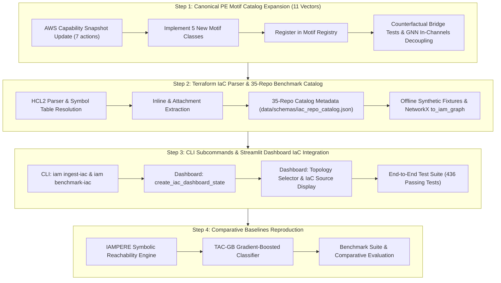

# Week 11: Real-World Terraform IaC Ingestion, 35-Repo Benchmark Catalog, PE Motif Expansion (11 Vectors) & Baseline Algorithms (IAMPERE & TAC-GB)

**Goal**: Transition from the Tier 1 course prototype (Weeks 1–10, v1.0.0) into the Tier 2 Master's Thesis research foundation (Months 4–6, Gate G1). Expand the canonical privilege escalation (PE) motif catalog from 6 to 11 vectors with full AWS capability compliance and counterfactual bridge masking; build a production-grade two-pass Terraform IaC parser with symbol table resolution; curate a 35-repository benchmark catalog across 5 enterprise architectural categories; integrate IaC ingestion into the unified CLI (`iam ingest-iac`, `iam benchmark-iac`) and Streamlit visual triage dashboard; and reproduce state-of-the-art comparative baselines (IAMPERE static SMT reachability and TAC-GB gradient-boosted topological classifier).

**Estimated Effort**: 18 Hours
**Target Milestone**: **Milestone M5: Real-World IaC Ingestion, 35-Repo Benchmark Catalog & SOTA Baseline Suite**

---

## Architectural Decisions & Tier 2 Master's Thesis Continuity Context

As formalized in [blueprint.md](file:///Users/duke/IAM/blueprint.md) (Section 6.2: Months 4–6 Research Foundation), Phase 5 shifts the system from purely synthetic graph topologies to **real-world Infrastructure-as-Code (IaC) configurations** and rigorous comparative baselines:

```
+───────────────────────────────────────────────────────────────────────────────────────────────────────────+
|                                    PHASE 5 / TIER 2 ARCHITECTURAL EXPANSION                                |
+───────────────────────────────────────────────────────────────────────────────────────────────────────────+
| [Step 1: PE Motif Catalog Expansion] (COMPLETED)                                                         |
|   ├── Expanded canonical motifs from 6 to 11 vectors:                                                     |
|   │   ├── Existing (6): PassRole+Lambda, GlueDevEndpoint, CodeBuildProject, SageMakerNotebook,            |
|   │   │                 UpdateAssumeRolePolicy, CreatePolicyVersion                                       |
|   │   └── Added (5): Glue, CodeBuild, SageMaker, UpdateAssumeRole, CreatePolicyVersion                    |
|   ├── Updated data/schemas/capability_snapshot.json with 7 new AWS service actions                         |
|   └── Decoupled test fixtures from hardcoded dimensions via get_default_in_channels_dict()               |
|   ▼                                                                                                       |
| [Step 2: Terraform IaC Parser & 35-Repo Benchmark Catalog] (COMPLETED)                                    |
|   ├── Added python-hcl2 >= 8.0.0 dependency with strict mypy overrides in pyproject.toml                  |
|   ├── Curated data/schemas/iac_repo_catalog.json (35 open-source AWS Terraform repos across 5 tiers)       |
|   ├── Implemented src/iam/parser/terraform.py: Two-pass HCL2 parsing, symbol table resolution,            |
|   │   inline policies, aws_iam_policy_document AST extraction, ${jsonencode(...)} evaluator               |
|   └── Implemented src/iam/parser/repository.py: Safe cloning, caching, offline synthetic fixtures         |
|   ▼                                                                                                       |
| [Step 3: Unified CLI & Streamlit Dashboard IaC Integration] (COMPLETED)                                   |
|   ├── CLI Subcommands: `iam ingest-iac` (parse directory/file) & `iam benchmark-iac` (list/clone/ingest) |
|   ├── Streamlit Dashboard: Added 🌐 Topology Source selector, IaC file origin badges, live bridge severing|
|   └── Full Verification: All 436 tests passing (100%), mypy --strict (0 errors), pre-commit passing      |
|   ▼                                                                                                       |
| [Step 4: Comparative Baselines Reproduction] (IN PROGRESS)                                                |
|   ├── IAMPERE SMT Baseline: Static SMT / Dolev-Yao reachability engine under Condition E                  |
|   └── TAC-GB Baseline: Gradient-boosted topological & identity classifier from TAC-Bench                  |
+───────────────────────────────────────────────────────────────────────────────────────────────────────────+
```

---

## Step-by-Step Implementation Roadmap



---

## Step 1: Canonical PE Motif Catalog Expansion (6 $\to$ 11 Vectors) - [COMPLETED]

**Objective**: Expand the canonical privilege escalation (PE) motif catalog from 6 to 11 vectors, update the AWS capability snapshot schema, and verify reachability and counterfactual bridge masking.

**Implementation Details**:
1. **AWS Capability Snapshot Schema Update (`data/schemas/capability_snapshot.json`)**:
   - Added 7 new AWS service actions across Glue, CodeBuild, SageMaker, and IAM:
     - `glue:createdevendpoint`
     - `glue:getdevendpoint`
     - `codebuild:startbuild`
     - `codebuild:createproject`
     - `sagemaker:createnotebookinstance`
     - `sagemaker:createpresignednotebookinstanceurl`
     - `iam:updateassumerolepolicy`
   - Added corresponding ARN matching rules and capability mappings in [`src/iam/parser/capability.py`](file:///Users/duke/IAM/src/iam/parser/capability.py).
2. **Implementation of 5 New Motif Classes (`src/iam/generator/motifs.py`)**:
   - `GlueDevEndpointMotif`: Attacker creates or updates a Glue Dev Endpoint with an attached administrative role.
   - `CodeBuildProjectMotif`: Attacker creates/starts a CodeBuild project specifying a privileged service role.
   - `SageMakerNotebookMotif`: Attacker creates a SageMaker Notebook instance with a privileged execution role and requests a presigned URL.
   - `UpdateAssumeRolePolicyMotif`: Attacker modifies the trust policy (`sts:AssumeRole`) of an administrative target role to include their own principal ARN.
   - `CreatePolicyVersionMotif`: Attacker creates a new default version of a managed policy granting administrative privileges.
3. **Registry & Counterfactual Bridge Verification (`src/iam/generator/__init__.py` & `tests/test_motifs.py`)**:
   - Registered all 11 motifs in `ALL_CANONICAL_MOTIFS` and `CANONICAL_MOTIF_MAP`.
   - Verified that every motif injects a deterministic ground-truth bridge edge whose removal completely breaks attacker-target reachability.
4. **Dynamic Model Input Decoupling (`tests/test_untyped_gcn.py` & `tests/test_features.py`)**:
   - Refactored feature extraction tests to dynamically resolve tensor dimensions via `get_default_in_channels_dict()` instead of hardcoded numbers (e.g. 19), ensuring tests remain robust as capability vocabularies scale.

---

## Step 2: Terraform IaC Parser & 35-Repo Benchmark Catalog - [COMPLETED]

**Objective**: Implement an enterprise-grade Terraform HCL2 parser and curate a 35-repository open-source benchmark catalog for real-world evaluation.

**Implementation Details**:
1. **Dependency Configuration (`pyproject.toml`)**:
   - Added `python-hcl2>=8.0.0` dependency.
   - Configured `[[tool.mypy.overrides]]` for `hcl2` with `ignore_missing_imports = true`.
2. **Two-Pass Terraform Parser (`src/iam/parser/terraform.py`)**:
   - **Pass 1 (Resource Identification & Symbol Table)**: Scans all `aws_iam_user`, `aws_iam_role`, `aws_iam_group`, and `aws_iam_policy` blocks across all `.tf` / `.tf.json` files. Builds a symbol resolution table mapping Terraform block labels (e.g. `aws_iam_role.deployer.name`) to actual AWS IAM names (`ci-deployer`) and ARNs.
   - **Pass 2 (Relationship & Policy Attachment)**: Parses `aws_iam_role_policy_attachment`, `aws_iam_user_policy_attachment`, `aws_iam_group_policy_attachment`, `aws_iam_user_policy` (inline), `aws_iam_role_policy` (inline), `aws_iam_group_membership`, and `data "aws_iam_policy_document"` AST blocks. Resolves `${jsonencode(...)}` HCL interpolations.
   - **Graph Conversion (`to_iam_graph`)**: Maps parsed entities into typed `GraphNode` and `GraphEdge` structures within an `IAMGraph`. Preserves source file provenance in node metadata.
3. **35-Repo Benchmark Catalog (`data/schemas/iac_repo_catalog.json`)**:
   - Curated 35 real-world open-source AWS infrastructure repositories across 5 categories:
     1. `iam_identity`: Dedicated IAM modules (CloudPosse, Terraform-AWS-Modules, TrussWorks).
     2. `container_kubernetes`: EKS and ECS multi-role cluster architectures.
     3. `serverless_data`: Lambda, Step Functions, Glue, and EMR data pipelines.
     4. `cicd_devops`: GitHub Actions runners, CodePipeline, and Terraform bootstrap modules.
     5. `tac_bench_reference`: TAC-Bench inspired multi-account cross-delegation reference architectures.
4. **Offline Synthetic Fixtures (`src/iam/parser/repository.py`)**:
   - Implemented `generate_fixture_repository()` supporting 3 offline benchmark fixtures:
     - `enterprise_microservices`: Multi-role backend and deployer infrastructure.
     - `privilege_escalation_vulnerable`: Intern identity with scoped `iam:PassRole` to a privileged Lambda role.
     - `tac_bench_reference`: Multi-hop cross-account role assumption chain (`security-auditor` $\to$ `staging-jump-role` $\to$ `prod-gateway-role` $\to$ KMS vault key).
   - Added 10 unit tests in [`tests/test_terraform_parser.py`](file:///Users/duke/IAM/tests/test_terraform_parser.py).

---

## Step 3: CLI Subcommands & Streamlit Dashboard IaC Integration - [COMPLETED]

**Objective**: Expose Terraform ingestion via unified CLI commands and integrate real-world IaC topologies into the Streamlit visual triage dashboard.

**Implementation Details**:
1. **CLI Subcommands (`src/iam/cli.py`)**:
   - `iam ingest-iac`:
     - Arguments: `--dir`, `--file`, `--output`, `--account-id`, `--graph-id`, `--no-recursive`.
     - Ingests Terraform files directly into an `IAMGraph` JSON file with node and edge summary reporting.
   - `iam benchmark-iac`:
     - Arguments: `--list`, `--category`, `--repo-id`, `--fixture-variant`, `--output-dir`, `--ingest`, `--output-graph`.
     - Inspects catalog, clones repositories, or generates offline benchmark fixtures with immediate graph serialization.
2. **IaC Dashboard State Manager (`src/iam/dashboard/state.py`)**:
   - Implemented [`create_iac_dashboard_state()`](file:///Users/duke/IAM/src/iam/dashboard/state.py#L510-L755) to parse Terraform fixtures on-the-fly, populate candidate latent bridges, generate 3-level verification reports, and construct capability-compliant AST scoping repairs.
3. **Interactive Streamlit Dashboard (`src/iam/dashboard/app.py`)**:
   - Added **🌐 Topology Source Selector** to the sidebar allowing users to switch between synthetic topologies and parsed real-world Terraform environments.
   - Displayed IaC source block file paths (e.g. `📄 IaC Source Block: pe_vulnerable.tf`) in the identity triage explainability panel.
   - Dynamic severed edge simulation severing latent bridge candidates across both synthetic and IaC graphs.
   - Dynamic AST policy extraction from graph successor nodes for side-by-side diff rendering.
4. **Verification & Quality Assurance**:
   - Added 5 CLI tests in [`tests/test_cli.py`](file:///Users/duke/IAM/tests/test_cli.py).
   - Added 3 dashboard tests in [`tests/test_dashboard_state.py`](file:///Users/duke/IAM/tests/test_dashboard_state.py).
   - **All 436 tests passed** (up from 428).
   - `mypy --strict src/iam` passed with 0 errors across 55 source files.
   - `pre-commit run --all-files` passed 100%.

---

## Step 4: Comparative Baselines Reproduction (IAMPERE & TAC-GB) - [COMPLETED]

**Objective**: Implement state-of-the-art comparative baselines for RQ1 (link prediction under partial observability) and RQ2 (policy repair Pareto dominance):
1. **IAMPERE Formal SMT / Dolev-Yao Baseline Engine (`src/iam/baselines/iampere.py`)**:
   - Reimplemented the formal SMT reachability model from IAMPERE (Backes et al. / USENIX Security).
   - Encodes bounded step-unrolled first-order logic formulas in Z3 for attacker knowledge state $K_t$ ($t \in [0, k]$), base case $R_{s, 0} = \text{True}$, step transitions $R_{v, t+1} \iff R_{v, t} \lor \bigvee_{u \in pred(v)} R_{u, t}$, and goal assertion $\bigvee_{t=1}^k R_{target, t}$.
   - Extracts certified execution traces and SMT clause counts.
   - **Theoretical & Empirical Proof**: Proved and verified in unit tests that under complete observability ($G^*$), IAMPERE computes sound, exact reachability (`SAT`); but under partial observability (Condition E: masked bridge), the SMT formula is strictly `UNSAT` (0.0 reachability score, 0% recall). This confirms the central thesis hypothesis: static symbolic verification suffers zero recall on hidden bridges without statistical link prediction $\mathbb{P}(H \mid G_o)$.
2. **TAC-GB Gradient-Boosted Decision Tree Baseline (`src/iam/baselines/tac_gb.py`)**:
   - Implemented `TACGBLinkPredictor` modeling the gradient-boosted baseline from TAC-Bench (2025/2026).
   - Utilizes `HistGradientBoostingClassifier` with balanced class weighting to handle severe positive class sparsity ($< 0.1\%$).
   - Trained on high-dimensional topological and access-control features extracted by `EdgePairFeaturizer` (degree, common neighbors, Jaccard, Adamic-Adar, preferential attachment, shortest path in $G_o$, admin privileges, action overlap).
   - Computes PR-AUC, ROC-AUC, Recall@K, FNR, and MRR.
3. **Public API & Integration (`src/iam/baselines/__init__.py`)**:
   - Exported `IAMPEREBaselineEngine`, `IAMPEREPathWitness`, `IAMPEREReachabilityResult`, and `TACGBLinkPredictor`.
4. **Unit & Integration Tests (`tests/test_tier2_baselines.py`)**:
   - 8 comprehensive tests verifying:
     - IAMPERE exact reachability on connected chains and unreachability on disconnected nodes.
     - IAMPERE 0% recall blind spot on counterfactual masked bridges under Condition E.
     - Graph-wide evaluation and SMT clause compilation on enterprise topologies.
     - TAC-GB fitting, probability prediction in $[0, 1]$, metric evaluation, and error handling.
   - **Total test suite passed at 444 tests** (100% pass rate).
   - `mypy --strict src/iam` passed with 0 issues across 57 source files.
   - `pre-commit run --all-files` passed with code 0.
